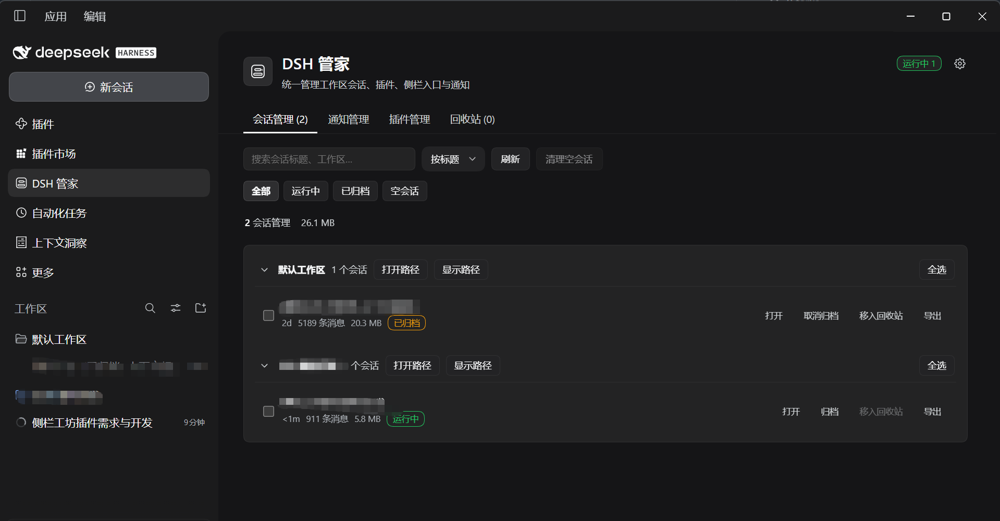
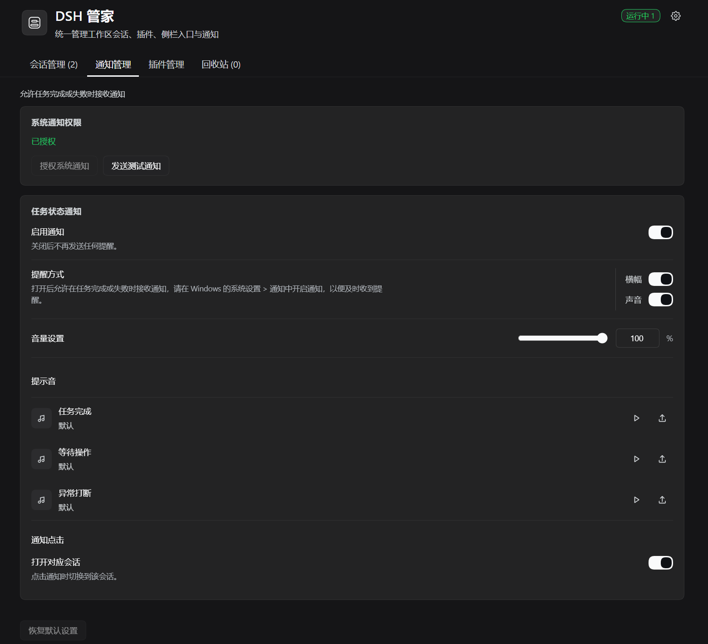
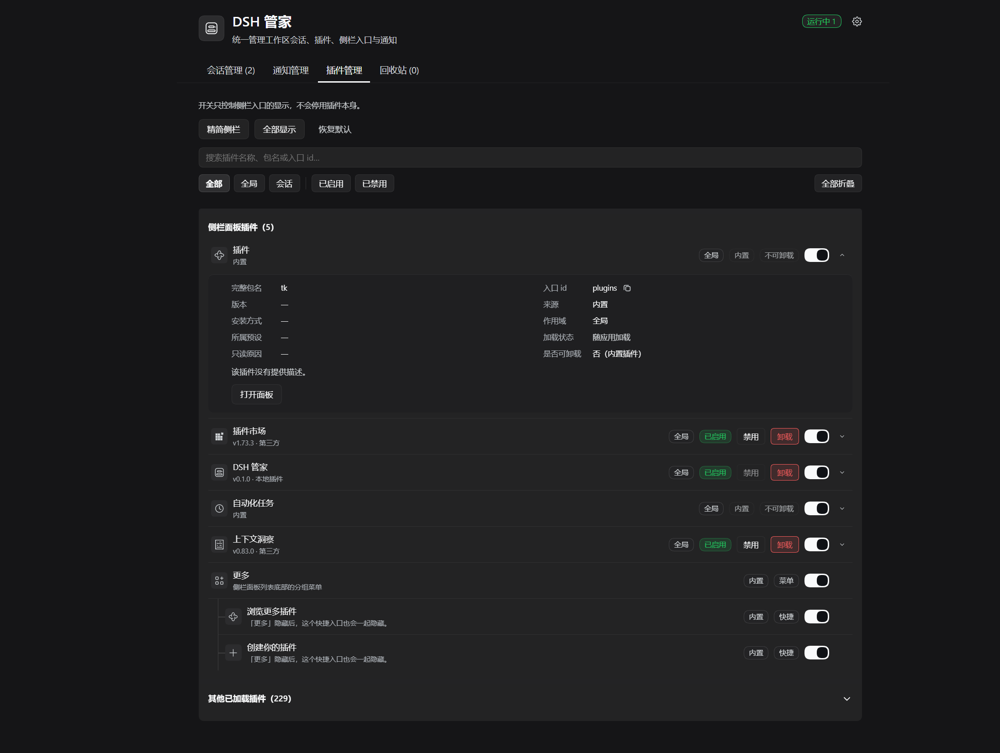
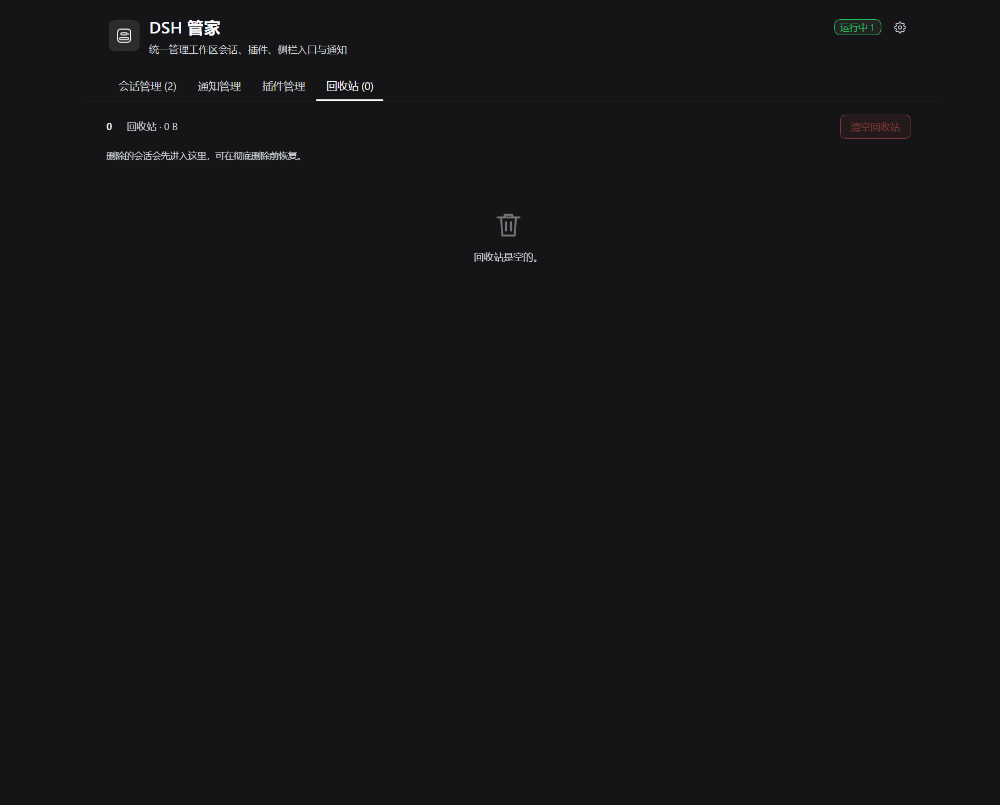

<p align="center">
  
</p>

<h1 align="center">DSH 管家 · DSH Keeper</h1>

<p align="center">
  统一管理 DeepSeek Harness 的工作区会话、插件、侧栏入口与任务通知。
</p>

<p align="center">
  <a href="https://www.npmjs.com/package/dsh-keeper-plugin"></a>
  <a href="https://github.com/swrabbit/dsh-keeper/blob/main/LICENSE"></a>
  
</p>

DSH 管家是一个带左侧栏入口的 DSH 插件。它把散落在 DSH 各处的事情收进一个管理页：
按工作区查看和清理会话、查看插件与侧栏入口、管理删除后的回收站，以及设置任务完成、
失败或等待操作时的横幅和提示音。

> 所有数据都留在本机。插件不联网、不上传会话内容，也不包含遥测。

## 界面预览

| 主面板 | 通知管理 |
| --- | --- |
|  |  |

| 插件管理 | 回收站 |
| --- | --- |
|  |  |

## 功能

### 会话管理

- 按工作区分组展示会话：标题、最后活动时间、消息数、日志占用，以及运行中、已归档、
  空会话等状态徽标。
- 搜索、按活动时间 / 大小 / 标题排序；当前工作区高亮；列表每 8 秒自动刷新。
- 三种删除方式，逐级可控：
  - **归档**：只从侧栏隐藏，随时可以取消归档，不移动磁盘文件。
  - **移入回收站**：先把运行中的会话停止并解绑，再把日志目录移入插件自己的回收站；
    可以恢复，也可以彻底删除。
  - **彻底删除**：二次确认，默认焦点在「取消」，Esc 关闭；确认框会显示标题、工作区和
    预计释放空间。运行中的会话禁止删除。
- 批量选择、批量归档、批量移入回收站；删除后有 5 秒撤销提示。
- 清理空会话、「空间占用排行」Top 5、删除前导出会话日志。
- 侧栏显示预设：精简 / 全部显示。

### 插件与侧栏入口

- 查看当前 profile 的插件清单、版本、bundle 信息和注册的侧栏入口。
- 展开插件行查看详情；入口名称冲突会提示。
- 逐项开关侧栏入口，即时生效并持久化。
- 只隐藏入口，不会停用插件本体；内置插件入口始终保留。

### 回收站

- 列出已删除会话的原工作区、原路径、大小和删除时间。
- 恢复到原路径并重新挂回工作区；也可以单项或批量彻底删除、清空回收站。
- 回收站元数据保存在 `~/.dsh/storages/dsh-keeper/trash/`，不碰 DSH 自己的会话存储格式。

### 通知管理

- 任务完成、任务失败、等待操作/审批时提醒；已处理 DSH 审批请求的 waterfall
  短路问题，等待审批也能收到提醒。
- 提醒方式：
  - **横幅**：仅当 DSH 在后台或窗口失焦时出现；窗口在前台时不弹横幅。
  - **声音**：前台、后台都会播放，可单独关闭。
- 音量滑杆与数字输入；内置提示音试听；支持自定义 mp3 / wav / ogg。
- 点击通知直接切换到对应会话；可一键恢复默认设置。
- 桌面通知不可用时，自动回落到应用内角标提示。

### 界面与本地化

- 中 / 英双语，跟随 DSH 语言自动切换。
- 使用 DSH 主题 token，自动适配 light / dark。
- 设置页位于「设置 → DSH 管家」，与侧栏入口使用同一枚管家图标。

## 安装

### 从插件市场安装（推荐，上架后）

1. 打开 DSH Desktop 的「设置 → 插件市场」。
2. 搜索 **DSH 管家** 或 `dsh-keeper-plugin`。
3. 安装后完全退出并重新启动 DSH。

### 从 npm 安装

在 DSH 的插件管理器中选择「安装 bundle / 从 npm 安装」，输入：

```text
dsh-keeper-plugin
```

安装完成后完全退出并重启 DSH。插件会以 bundle 形式并入当前 profile。

### 本地开发安装

```bash
git clone https://github.com/swrabbit/dsh-keeper.git
cd dsh-keeper
```

把该目录链接到 DSH profile 的依赖中，或在插件管理器里选择本地 bundle 目录。具体命令取决于
你的 DSH profile 布局；开发调试与测试命令见 [docs/DEVELOPMENT.md](https://github.com/swrabbit/dsh-keeper/blob/main/docs/DEVELOPMENT.md)。

## 使用

安装并重启后，左侧栏底部会出现「DSH 管家」入口。点击后在主工作区打开管理页，顶部标签为：

1. **会话管理**
2. **通知管理**
3. **插件管理**
4. **回收站**

设置页在「设置 → DSH 管家」，包含默认删除行为、彻底删除二次确认、入口显示和通知偏好。

## 数据与权限

| 内容 | 位置 |
| --- | --- |
| 插件设置、侧栏隐藏项 | `~/.dsh/storages/dsh-keeper/state.json` |
| 回收站 | `~/.dsh/storages/dsh-keeper/trash/<trashId>/` |
| 回收站条目元数据 | 同上目录下的 `.dsh-keeper-trash.json` |
| 会话日志（只读写 DSH 已有文件） | `~/.dsh/sessions/<workspace>/session-<uuid>/session.v4.jsonl.zstd` |

插件使用 DSH 的 Host 服务完成这些操作：读取工作区与会话清单、停止/解绑运行中的会话、
把会话目录移入回收站、恢复时移回原路径并重新挂载。所有本机 API 只接受同源 POST，
并通过 `ctx.connection.requestRejection` 做信任校验。

插件**不会**：

- 上传会话内容、日志或工作区路径；
- 读取与插件功能无关的文件；
- 修改 DSH 安装目录或全局 npm 包；
- 在后台自动删除任何会话。

从旧版本升级时，首次加载会把旧数据目录、回收站元数据和界面偏好迁移到 `dsh-keeper`；
旧目录会保留一版作为回退，不会自动删除。

## 兼容性

- 主要在 **DSH Desktop 0.2.2-rc.1（Windows）** 上开发和验证。
- `package.json` 声明 `engines.dsh: ">=0.2.2-rc.1 <0.3.0"`。超出该范围的新版本可能可用，
  但未经过验证。
- macOS / Linux 版 DSH 尚未做完整回归；如果遇到平台差异，欢迎提 issue。

### 已知限制

- 侧栏入口的显示/隐藏是客户端样式层实现。DSH 宿主改版导致类名变化时，入口可能重新出现，
  但不会报错，也不会影响插件本体。
- 运行中的会话不能直接删除；需要先停止任务或等待任务结束。
- 彻底删除不可撤销；回收站删除是安全的中间层。

## 开发

```bash
# Host API（真实会话日志、回收站、迁移、路径安全）
node .dsh-keeper-dev/test-api.mjs

# Client 冒烟（模块装载、槽位注册、组件渲染）
node .dsh-keeper-dev/test-client.mjs

# 面板展开（搜索、chevron、通知设置卡片）
node .dsh-keeper-dev/test-expand.mjs
```

三套测试当前分别为 **102/102、88/88、42/42** 通过。开发过程、设计取舍和历史迭代记录保留在
[docs/DEVELOPMENT.md](https://github.com/swrabbit/dsh-keeper/blob/main/docs/DEVELOPMENT.md)。

## 反馈

- Issue：<https://github.com/swrabbit/dsh-keeper/issues>
- 市场条目：awesome-dsh-plugin 收录后可在 DSH 插件市场直接搜索。

## License

[MIT](https://github.com/swrabbit/dsh-keeper/blob/main/LICENSE) © 2026 supaleyer
